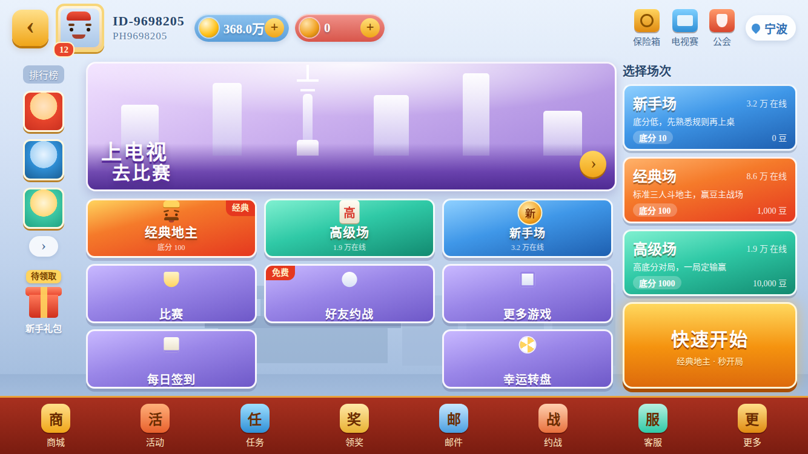
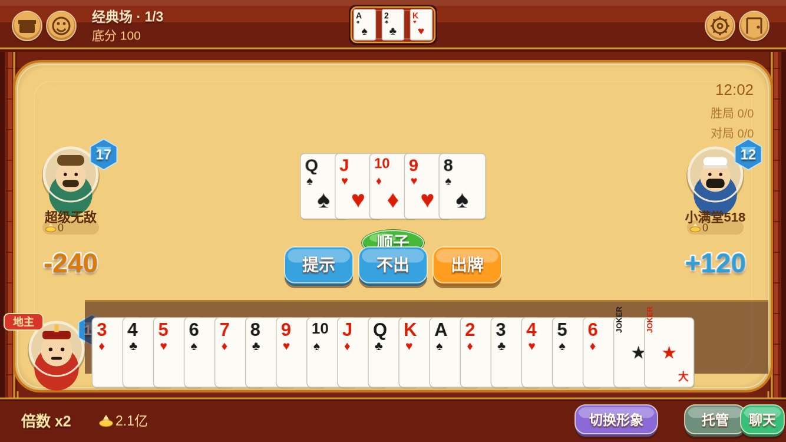

# 欢乐斗地主 · 复刻工程

对腾讯《欢乐斗地主》（Android `com.qqgame.hlddz` 8.050.016 / 微信小游戏 `wxd0e404d795ea6f80`）的界面与玩法复刻。

前端是 **uni-app + Phaser 3.90**，后端是 **Go + cherry-game**。**横屏设计**，逻辑分辨率 1334x750。界面按官方实机截图与 APK 内配置表逐项对齐，牌局逻辑按配置表抽取的规则实现。

---

## 界面效果

| 大厅 | 牌桌对局 |
|---|---|
|  |  |

| 叫分阶段 | 快捷语音 |
|---|---|
|  |  |

---

## 目录结构

```
hlddz-replica/
├── ui/                        前端（可直接并入 uni-app 工程）
│   ├── pages/game/
│   │   ├── hall.vue           游戏大厅（1334x750 设计稿，运行时等比缩放）
│   │   ├── ddz.vue            牌桌页面外壳（连接、音效调度）
│   │   ├── ddz-game.js        Phaser 牌桌场景（布局、交互、特效）
│   │   ├── ddz-theme.js       视觉主题与绘制原语（木框、绒布、牌面、头像）
│   │   ├── ddz-net.js         WebSocket 封装（NDJSON 分帧）
│   │   └── ddz-audio.js       Web Audio 合成音效
│   └── static/
│       ├── game/phaser.min.js Phaser 3.90 运行库
│       └── preview-ddz.html   免后端预览页（内置示例牌局）
├── server/                    后端（Go 1.24 + cherry v1.6.9）
│   ├── main.go                服务入口，默认监听 :9104
│   ├── gateway/               网关层：连接管理、指令分发、状态下发
│   ├── game/                  牌局内核：牌型判定、房间状态机、AI
│   ├── etc/profile/dev.json   节点配置（场次、底分、机器人补位）
│   └── test_client.py         命令行联调脚本
├── docs/                      需求规格文档（8 份）
└── deploy/                    Nginx 反向代理示例
```

---

## 快速开始

### 1. 只看界面（不需要后端）

预览页内置一副示例牌局，直接静态托管即可：

```bash
cd ui/static
python3 -m http.server 8080
# 浏览器打开 http://localhost:8080/preview-ddz.html
```

注意必须用 HTTP 访问，`file://` 下 ES Module 会被浏览器拦截。

### 2. 并入 uni-app 工程

把 `ui/pages/game/` 拷到工程 `src/pages/game/`，`ui/static/game/` 拷到 `src/static/game/`，然后在 `pages.json` 注册两条路由：

```json
{ "path": "pages/game/hall", "style": { "navigationStyle": "custom", "backgroundColor": "#d3e0f4" } },
{ "path": "pages/game/ddz",  "style": { "navigationStyle": "custom", "backgroundColor": "#4a0f09" } }
```

页面按 1334x750 横屏逻辑分辨率设计，`Scale.FIT` 自适应。后端地址在 `ddz-net.js` 顶部 `WS_URL` 配置。

宿主工程需要打开横屏：`manifest.json` 的 `app-plus` 中加 `"screenOrientation": ["landscape-primary"]`，游戏两页的 `pages.json` style 中加 `"pageOrientation": "landscape"`。若工程启用了 PC 宽屏适配（页面被装入竖屏模拟 iframe），游戏页会在进入时自动解除、离开时恢复。

### 3. 启动后端

```bash
cd server
go build -o ddz-server .
./ddz-server            # 默认 :9104
```

静态编译（目标机 glibc 较旧时）：

```bash
CGO_ENABLED=0 GOOS=linux GOARCH=amd64 go build -tags netgo -ldflags '-s -w' -o ddz-server .
```

可用环境变量：`DDZ_ADDR`（监听地址）、`DDZ_PROFILE`（配置路径）、`DDZ_NODE`（节点 ID）。

联调：

```bash
python3 test_client.py ws://127.0.0.1:9104/ws
```

---

## 通信协议

WebSocket，**换行分隔 JSON（NDJSON）**。每帧一条完整 JSON，以 `\n` 结尾，避免 TCP 粘包导致解析失败。

```
客户端 → {"cmd":"play","data":{"cards":[{"suit":3,"rank":14}]}}
服务端 → {"cmd":"state","data":{...}}
```

| 指令 | 参数 | 说明 |
|---|---|---|
| `login` | `token` `nickname` | 建立会话 |
| `join` | — | 进桌，满 3 人开局 |
| `ready` | — | 准备 |
| `bid` | `score` 0/1/2/3 | 叫分，0 为不叫 |
| `double` | `double` bool | 加倍 / 不加倍 |
| `play` | `cards` | 出牌 |
| `pass` | — | 不出 |

下行 `state` 为按请求者视角裁剪的快照：`phase_code`（1 叫分 / 2 加倍 / 3 出牌）、`my_cards`、`players[]`、`last_cards`、`bottom`、`multiplier` 等。

---

## 已实现的玩法

- **牌型判定**：单张、对子、三张、三带一、三带二、顺子、连对、飞机（带单/带对）、四带二、炸弹、王炸，两级压制（`王炸 > 炸弹 > 普通牌型`）
- **叫分**：1/2/3 分轮转，最高分得地主，三家不叫流局重发
- **加倍**：叫分后各自选择加倍，记 `DoubleDone` 防止重复轮转
- **结算**：底分 × 倍数，地主对两名农民分别结算；炸弹每个 ×2；春天与反春 ×2
- **托管**：掉线转 AI 接管，避免卡局
- **AI**：跟牌最小压制、领出拆牌优先，机器人自动准备与加倍

---

## 与原版的对照

| 维度 | 原版依据 | 复刻实现 |
|---|---|---|
| 场次命名 | `SceneLayoutCfg3D` | 新手场 / 普通场 / 高级场 |
| 快捷短语 | `GameTalkConfigCfg` | 九条文案原文，如“不要出，让我来” |
| 牌型特效 | `ItemInfoCfg3D` | 炸弹、王炸、春天三类特效节点 |
| 桌面配色 | `UITableStyleCfg` | `#a4632e` 木框 / `#5c6181` 辅色 |
| 规则骨架 | `PlayModeRuleCfg3D[54][55]` | 两级压制与炸弹倍数 |
| 版式比例 | 实机横屏截图 | 1334x750 等比映射 |

---

## 已知限制

**原始位图与音频未能提取。** APK 内 842 个 AssetBundle 全部加密：头魔数被改为 `UnityHLDDZ`、大端序、flags `0x43`、熵 7.67；LZ4、LZMA、zlib 三种解压均失败，360 个候选偏移暴力扫描无命中，解密入口走 GOT 间接调用未能定位。`sharedassets*.assets` 内只有 Cubemap 与 PreloadData，不含 UI 图集。APK 内明文音频数量为 0。

因此当前美术为**矢量重绘**、音效为 **Web Audio 合成**：版式、比例、配色、交互位置、文案与原版一致，但非原始素材。

若要 1:1 还原，需要以下任一条件：

1. 提供官方素材包（图集 + 音频）；
2. 在已 Root 的真机上运行游戏，于运行时 dump 内存中解密后的资源；
3. 定位解密函数并还原算法后离线批量解密。

---

## 参考文档

`docs/` 下 8 份需求规格文档覆盖产品架构、启动登录、大厅、牌桌对局、结算、玩法规则、资源规范与自审记录，含 104 条验收用例。

---

## 声明

本项目仅用于技术研究与学习，不含任何原版素材，与原著作权方无关联。相关商标、美术形象、音频版权归其权利人所有。
